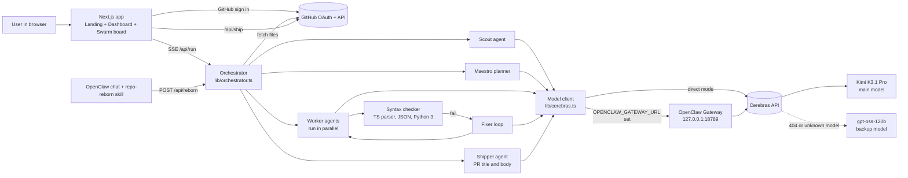

# Repo Reborn

A swarm of Kimi K3.1 Pro agents on Cerebras that rebuilds old repos. Built for the Cerebras x Kimi K3.1 Pro hackathon. Runs on the OpenClaw harness.

Paste a GitHub link. Scout maps the repo. Maestro writes the plan. Many worker agents rewrite files at the same time. Every file goes through a real syntax check and gets fixed if it fails. Shipper writes the pull request. You download the new repo or open the PR from the app.

## What it does

| Mode | Track | What it does |
| --- | --- | --- |
| Migrate | Refactor legacy code | Moves old code (jQuery, PHP 5, Python 2) to a target stack |
| Secure | Refactor legacy code | Finds security bugs and patches each file |
| Docs | Explore codebases | Docs for every file plus a README |
| Explore | Explore codebases | Explains each file, then lets you ask questions about the repo |
| All | Build agents | Multi agent orchestration with a live swarm board |
| TPS Lab | Speed | Finds the prompt with the fastest tokens per second |

## Architecture



### How a run flows

```
fetch  -> pulls code files from GitHub (or the built in old shop demo)
scout  -> one call maps the repo and picks the order
plan   -> Maestro writes shared rules for every worker
work   -> N workers pull from one queue and stream their file
verify -> real syntax check. Fixer loop retries on failure
ship   -> Shipper writes the PR title, body and README
```

Events stream to the browser over server sent events. The swarm board shows each agent, each file and the live tokens per second. The board has zoom and a full screen button.

## Integrations

| Integration | What it does | Where |
| --- | --- | --- |
| Cerebras API | Fast inference for every agent. OpenAI compatible streaming | `lib/cerebras.ts` |
| Kimi K3.1 Pro | Main model. Model id `moonshotai-kimi-k3.1-pro-trial` | `CEREBRAS_MODEL` |
| OpenClaw harness | Every agent call can run as an OpenClaw turn through the Gateway | `OPENCLAW_GATEWAY_URL` |
| OpenClaw skill | Start a swarm from OpenClaw chat | `openclaw/skills/repo-reborn` |
| GitHub OAuth | Sign in to read private repos and open PRs | `app/api/auth/*` |
| GitHub API | Fetch repo files and open pull requests | `lib/github.ts`, `app/api/ship` |

## OpenClaw harness

Set `OPENCLAW_GATEWAY_URL` and every agent call becomes an OpenClaw agent turn. The app sends the Cerebras model in the `x-openclaw-model` header and starts a fresh session per call so agents never share history.

Setup in short:

1. Install OpenClaw. On Windows run `iwr -useb https://openclaw.ai/install.ps1 | iex`
2. In the wizard pick Cerebras and paste your key
3. `openclaw config set gateway.http.endpoints.chatCompletions.enabled true`
4. Set a gateway token with `openclaw config set gateway.auth.token <token>` then `openclaw gateway restart`
5. Put these in `.env`: `OPENCLAW_GATEWAY_URL=http://127.0.0.1:18789`, `OPENCLAW_GATEWAY_TOKEN=<token>`, `REBORN_API_KEY=<any secret>`
6. Install the skill from `openclaw/skills/repo-reborn` into your OpenClaw workspace `skills` folder

Full steps are in `openclaw/SETUP.md`. Check your setup at `/api/models?probe=1`.

### Start a swarm from OpenClaw chat

The skill calls `POST /api/reborn` with header `x-reborn-key`. It returns one JSON result.

```bash
curl -s -X POST http://localhost:3000/api/reborn \
  -H "Content-Type: application/json" \
  -H "x-reborn-key: $REBORN_API_KEY" \
  -d '{"repo":"owner/repo","mode":"migrate","target":"TypeScript","saver":"tiny"}'
```

## Backup model

Kimi is always tried first. If Cerebras says the model is not open to your key (404 or unknown model), the app runs the same call on `CEREBRAS_FALLBACK_MODEL` (default `gpt-oss-120b`). It tries Kimi again after 5 minutes. The status badge and the run header always show the model that really ran, with "(backup)" when it is the backup. Set `CEREBRAS_FALLBACK_MODEL=off` to turn the backup off.

## Credit saver

Cerebras credits are limited, so every run has a hard token cap. The cap is strict. Each file reserves its worst case tokens before it starts.

| Profile | Files | Token cap | Workers | Fix tries |
| --- | --- | --- | --- | --- |
| Tiny (default) | 8 | 30k | 4 | 0 |
| Balanced | 15 | 80k | 6 | 1 |
| Full | 60 | 400k | 12 | 2 |

Tiny also skips the Scout and Shipper model calls. Reasoning effort is low by default. Set `TOKEN_BUDGET_MAX` to lower every cap.

## Run it

```bash
npm install
cp .env.example .env     # Windows: copy .env.example .env
# put your Cerebras key in .env
npm run dev
```

Open http://localhost:3000 for the landing page. The dashboard is at http://localhost:3000/dashboard

Without a key the app runs a simulated swarm so you can still see the full flow.

## Environment

| Name | Needed | Notes |
| --- | --- | --- |
| CEREBRAS_API_KEY | Yes for real runs | From cloud.cerebras.ai |
| CEREBRAS_MODEL | Yes | Default `moonshotai-kimi-k3.1-pro-trial` |
| CEREBRAS_FALLBACK_MODEL | No | Default `gpt-oss-120b`. `off` disables it |
| CEREBRAS_BASE_URL | No | Default `https://api.cerebras.ai/v1` |
| CEREBRAS_REASONING_EFFORT | No | Default `low`. `off` stops sending it |
| TOKEN_BUDGET_MAX | No | Lowers every profile cap |
| SWARM_MAX_WORKERS | No | Caps workers |
| SWARM_MAX_FILES | No | Caps files |
| OPENCLAW_GATEWAY_URL | For OpenClaw mode | `http://127.0.0.1:18789` |
| OPENCLAW_GATEWAY_TOKEN | For OpenClaw mode | Your gateway token |
| OPENCLAW_AGENT | No | Default `openclaw/default` |
| REBORN_API_KEY | For the skill | Secret for `/api/reborn` |
| GITHUB_CLIENT_ID | For sign in | From a GitHub OAuth App |
| GITHUB_CLIENT_SECRET | For sign in | Same page |
| SESSION_SECRET | For sign in | Long random text |
| GITHUB_TOKEN | No | Higher read limits when you skip sign in |

## GitHub sign in

Set the three sign in vars and the dashboard needs a GitHub login. The swarm then reads your private repos and opens PRs with your login. No token to paste. Your token lives in an encrypted httpOnly cookie. Without the vars the app runs in guest mode.

OAuth App settings: Homepage `http://localhost:3000`. Callback `http://localhost:3000/api/auth/callback`. Always open the app at `localhost:3000`.

## Shipping the result

When a run ends you can download the new repo as a zip. Or press Ship to open a pull request on the repo. The PR uses the title and body that Shipper wrote.

## API routes

| Route | Use |
| --- | --- |
| `POST /api/run` | Start a swarm. Streams events |
| `POST /api/reborn` | One shot run for the OpenClaw skill |
| `POST /api/ask` | Ask questions about the repo (Explore mode) |
| `POST /api/ship` | Open the pull request |
| `POST /api/tps` | Speed test for TPS Lab |
| `GET /api/models` | List models and the harness. Add `?probe=1` to run a test call |
| `GET /api/status` | Live or simulated status and model |
| `/api/auth/*` | GitHub sign in, sign out, repos |

## Project map

- `lib/orchestrator.ts` the agent pipeline and token budget
- `lib/cerebras.ts` streaming client, OpenClaw mode, backup model, tokens per second
- `lib/profiles.ts` credit saver profiles
- `lib/checker.ts` real syntax checks
- `lib/github.ts` repo fetch and pull request
- `components/SwarmBoard.tsx` the live swarm board
- `components/Studio.tsx` the run page. The run survives page changes
- `openclaw/` setup guide, config sample and the skill

## Deploy

Push to GitHub and import in Vercel. Add the env vars. Long runs need a plan that allows 300 second functions. OpenClaw mode needs the Gateway on the same machine, so use direct mode on Vercel.
